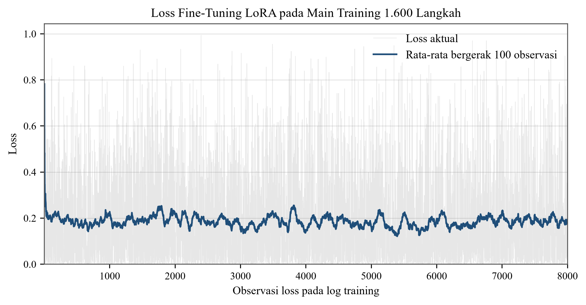
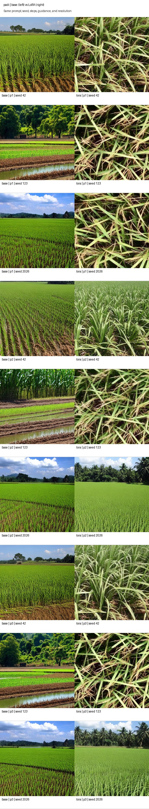
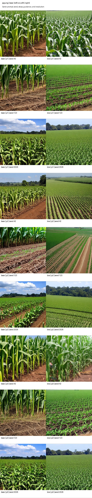
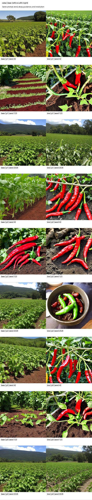
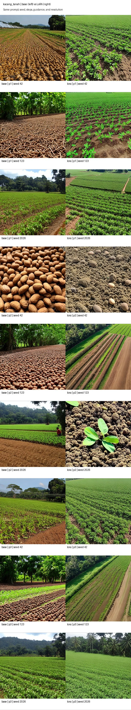
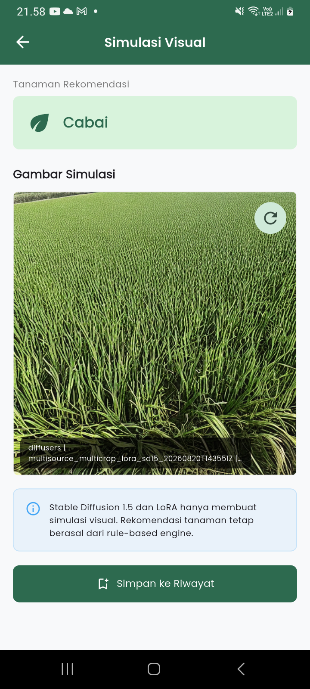
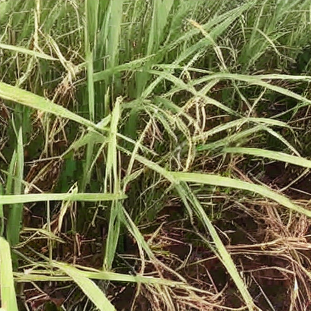

# LAMPIRAN FINAL SKRIPSI TANIADAPTIF

Dokumen ini disusun hanya dari artefak yang telah tersedia di repository `D:\TaniAdaptif`. Tidak ada sistem, test, build, training, inference, Kaggle, backend, atau perangkat Android yang dijalankan untuk menyusun lampiran ini.

## LAMPIRAN 1
## DOKUMENTASI IMPLEMENTASI APLIKASI MOBILE

### Lampiran 1.1 Tampilan Halaman Beranda dan Informasi Cuaca

`[SCREENSHOT MANUAL 1.1]`

Berkas kandidat yang sudah tersedia: `L1_01_Beranda_Cuaca_existing.png`.

**Keterangan:** Halaman beranda menampilkan informasi cuaca wilayah Aikmel yang digunakan sebagai salah satu masukan dalam proses rekomendasi.

**Sumber:** Dokumentasi Peneliti, 2026.

### Lampiran 1.2 Tampilan Halaman Input Kondisi Lahan

`[SCREENSHOT MANUAL 1.2]`

**Keterangan:** Halaman input digunakan untuk memasukkan jenis lahan, ketersediaan air, dan tanaman sebelumnya sebelum rule-based engine memproses rekomendasi.

**Sumber:** Dokumentasi Peneliti, 2026.

### Lampiran 1.3 Tampilan Halaman Hasil Rekomendasi

`[SCREENSHOT MANUAL 1.3]`

**Keterangan:** Halaman hasil menampilkan tanaman prioritas, alternatif tanaman, alasan rekomendasi, serta rencana rotasi berdasarkan rule-based engine.

**Sumber:** Dokumentasi Peneliti, 2026.

### Lampiran 1.4 Tampilan Halaman Simulasi Visual

`[SCREENSHOT MANUAL 1.4]`

Berkas kandidat yang sudah tersedia: `L1_04_Simulasi_Visual_existing.png`.

**Keterangan:** Halaman simulasi menampilkan gambar yang dihasilkan Stable Diffusion 1.5 dan LoRA. Gambar hanya berfungsi sebagai visualisasi; rekomendasi tanaman tetap berasal dari rule-based engine.

**Sumber:** Dokumentasi Peneliti, 2026.

### Lampiran 1.5 Tampilan Halaman Riwayat

`[SCREENSHOT MANUAL 1.5]`

**Keterangan:** Halaman riwayat menampilkan rekomendasi dan simulasi visual yang pernah disimpan pada perangkat.

**Sumber:** Dokumentasi Peneliti, 2026.

## LAMPIRAN 2
## BUKTI PENGUJIAN SISTEM

### Lampiran 2.1 Ringkasan Hasil Pengujian Perangkat Lunak

| Bukti | Hasil penting | Sumber artefak |
| --- | --- | --- |
| Health backend | Endpoint kesehatan memenuhi kontrak dasar | `artifacts/test_reports/node_backend_tests.txt` |
| Validasi rekomendasi | Input valid menghasilkan rekomendasi dan rule ID; input salah ditolak | `artifacts/test_reports/node_backend_tests.txt` |
| Decision table | Seluruh 30 kunci menghasilkan keluaran valid, dapat diaudit, dan mencakup empat kelas | `artifacts/test_reports/node_backend_tests.txt` |
| Parser BMKG | Nilai curah hujan yang tidak tersedia dipertahankan sebagai `null` | `artifacts/test_reports/node_backend_tests.txt` |
| Cache BMKG | Urutan network, fresh-cache, dan stale-cache telah diuji | `artifacts/test_reports/node_backend_tests.txt` |
| Inference API | 29 test Python inference lulus pada verifikasi 21 Agustus 2026 | `thesis_output/evidence/software_verification_20260821.json` |
| Proxy visual | Kontrak Express ke provider mock dan pengiriman PNG melalui backend lulus | `artifacts/test_reports/backend_inference_proxy_live_contract.json` |
| Riwayat Flutter | Penyimpanan, pembacaan, dan batas jumlah riwayat diuji pada suite Flutter | `artifacts/test_reports/flutter_tests.txt` |

Ringkasan verifikasi pada 21 Agustus 2026 mencatat 125 test Python, 23 test backend, dan 13 test Flutter lulus. Pengujian UI terdiri atas 11 test dataset review dan 7 test LoRA review. Flutter static analysis juga mencatat `No issues found`.

**Sumber:** Hasil Pengujian Peneliti, 2026.

## LAMPIRAN 3
## BUKTI INTEGRASI DATA BMKG

### Lampiran 3.1 Ringkasan Respons Live BMKG Wilayah Aikmel

| Item | Hasil aktual |
| --- | --- |
| Kode wilayah ADM4 | `52.03.09.2002` |
| Desa/Kecamatan | Aikmel/Aikmel |
| Kabupaten | Lombok Timur |
| Provinsi | Nusa Tenggara Barat |
| Status cuaca | Berhasil |
| Jumlah titik prakiraan | 18 |
| Horizon | 3 hari |
| Titik curah hujan tersedia | 18 dari 18 |
| Kalender rekomendasi | 4 minggu |
| Contoh rekomendasi | cabai |
| Rule ID | `ROT-RENDAH-CUKUP-PADI-SAWAH` |

Respons live yang disimpan menunjukkan data BMKG Aikmel berhasil dinormalisasi dan diproses tanpa membuat nilai curah hujan fiktif. Kalender empat minggu merupakan proyeksi aplikasi berdasarkan horizon yang tersedia, bukan prakiraan iklim bulanan resmi BMKG.

**Sumber:** Hasil Pengujian Peneliti, 2026. Artefak: `artifacts/test_reports/node_bmkg_live_summary.json`.

## LAMPIRAN 4
## RULE-BASED ENGINE DAN DECISION TABLE

### Lampiran 4.1 Ringkasan Kontrak Decision Table

| Unsur | Nilai |
| --- | --- |
| Kategori hujan | tinggi, sedang, rendah |
| Ketersediaan air untuk kunci utama | cukup, terbatas |
| Tanaman sebelumnya | padi, jagung, cabai, kacang tanah, kosong |
| Jenis lahan | sawah, tegalan, kebun campur |
| Jumlah kunci utama | 30 |
| Kelas keluaran | padi, jagung, cabai, kacang tanah |
| Bidang audit | tanaman prioritas, daftar rekomendasi, alasan, input summary, rule ID |

Contoh skenario yang tersimpan menggunakan kategori hujan rendah, air cukup, tanaman sebelumnya padi, dan lahan sawah. Sistem memberikan prioritas cabai dengan rule ID `ROT-RENDAH-CUKUP-PADI-SAWAH`. Seluruh 30 kunci telah diuji secara otomatis. Hasil ini membuktikan kontrak perangkat lunak, bukan kebenaran agronomi universal. Validasi ahli agronomi tidak diklaim.

**Sumber:** Hasil Pengujian Peneliti, 2026. Artefak: `docs/DECISION_TABLE.md`, `backend-nodejs/src/config/aturanRotasi.js`, dan `artifacts/test_reports/node_backend_tests.txt`.

## LAMPIRAN 5
## DATASET DAN PROSES FINE-TUNING LORA

### Lampiran 5.1 Distribusi Dataset Final

| Komoditas | Total final | Train | Validation |
| --- | ---: | ---: | ---: |
| padi | 95 | 76 | 19 |
| jagung | 100 | 80 | 20 |
| cabai | 97 | 78 | 19 |
| kacang tanah | 97 | 78 | 19 |
| **Total** | **389** | **312** | **77** |

Seluruh gambar final mempunyai keputusan kurasi manusia `accepted=yes`. Dataset digunakan untuk fine-tuning LoRA sebagai visualisasi empat komoditas dan tidak digunakan untuk menentukan rekomendasi tanaman.

**Sumber:** Dokumentasi Peneliti, 2026. Artefak: `docs/DATASET_CARD.md`.

### Lampiran 5.2 Ringkasan Training Final

| Tahap | Hasil |
| --- | --- |
| Run final | `20260820T143551Z` |
| GPU | 2 x Tesla T4 |
| Smoke test | Lulus, 100 steps, 4 menit 10,79 detik |
| Main training | Selesai, 1.600 steps, 55 menit 46,29 detik |
| File LoRA | `multisource_multicrop_lora.safetensors` |
| Ukuran | 6.414.992 byte |
| Tensor | 256 |
| SHA-256 | `0bda8908d577513110c22cf5ec1b8a7e008d2b26dd90525732a5c4e4b1bdd43a` |
| Sanity images | 4 dari 4 valid |

**Caption Word:** Lampiran 5.1 Grafik Loss Fine-Tuning LoRA pada Main Training

Loss merupakan bukti proses optimisasi yang finite dan tidak dipakai sebagai bukti tunggal kualitas perseptual gambar.

**Sumber:** Hasil Pengujian Peneliti, 2026. Artefak: `artifacts/model_evaluation/kaggle_run_20260820T143551Z/RESULTS.md`.

### Lampiran 5.3 Screenshot Ringkasan Training Kaggle

`[SCREENSHOT MANUAL 5.3]`

**Caption Word:** Lampiran 5.2 Ringkasan Run Training Final LoRA pada GPU Kaggle

Instruksi aman tersedia pada `CHECKLIST_SCREENSHOT_MANUAL.md` bagian SS-06. Screenshot ini bersifat pelengkap karena bukti training final sudah tersedia secara lokal.

## LAMPIRAN 6
## HASIL EVALUASI STABLE DIFFUSION DAN LORA

### Lampiran 6.1 Ringkasan Evaluasi Manusia

Data review final terdiri atas 72 penilaian lengkap atau 36 pasangan Base-LoRA. Setiap komoditas mempunyai sembilan kondisi, dan prompt serta seed identik di dalam setiap pasangan. Analyzer mencatat `automated_scores_inserted=false`.

| Metrik | Base | LoRA | Selisih LoRA-Base | p exact |
| --- | ---: | ---: | ---: | ---: |
| Kesesuaian komoditas | 31/36 (86,11%) | 34/36 (94,44%) | +8,33 poin persentase | 0,25 |
| Median konteks | 4,5 | 4,0 | -0,5 | 0,607239 |
| Median realisme | 4,5 | 4,0 | -0,5 | 0,607239 |

Peningkatan kesesuaian komoditas bersifat deskriptif dan tidak signifikan pada exact McNemar dengan taraf 0,05. Hasil tidak mendukung klaim bahwa LoRA unggul pada seluruh dimensi visual.

**Sumber:** Hasil Pengujian Peneliti, 2026. Artefak: `artifacts/model_evaluation/kaggle_run_20260820T143551Z/POST_REVIEW_ANALYSIS_REPORT.md`.

### Lampiran 6.2 Ringkasan per Komoditas

| Komoditas | N pasangan | Benar Base | Benar LoRA | Median konteks Base/LoRA | Median realisme Base/LoRA |
| --- | ---: | ---: | ---: | ---: | ---: |
| padi | 9 | 100,00% | 100,00% | 4/4 | 4/4 |
| jagung | 9 | 100,00% | 100,00% | 5/4 | 5/4 |
| cabai | 9 | 100,00% | 100,00% | 5/5 | 5/5 |
| kacang tanah | 9 | 44,44% | 77,78% | 2/4 | 2/4 |

### Lampiran 6.3 Contact Sheet Base dan LoRA

**Caption Word:** Lampiran 6.1 Perbandingan Base dan LoRA pada Komoditas Padi

**Caption Word:** Lampiran 6.2 Perbandingan Base dan LoRA pada Komoditas Jagung

**Caption Word:** Lampiran 6.3 Perbandingan Base dan LoRA pada Komoditas Cabai

**Caption Word:** Lampiran 6.4 Perbandingan Base dan LoRA pada Komoditas Kacang Tanah

**Caption Word:** Lampiran 6.5 Perbandingan Kesesuaian Komoditas Base dan LoRA

**Caption Word:** Lampiran 6.6 Perbandingan Kesesuaian Base dan LoRA per Komoditas

**Sumber:** Hasil Pengujian Peneliti, 2026.

## LAMPIRAN 7
## BUKTI INFERENCE GPU END-TO-END

### Lampiran 7.1 Alur Integrasi End-to-End

Alur yang dibuktikan pada lingkungan pengujian adalah:

`Flutter Android -> Express -> FastAPI -> CUDA -> Stable Diffusion 1.5 + LoRA -> PNG -> Express -> Android`

**Caption Word:** Lampiran 7.1 Hasil Inference End-to-End yang Tampil pada Aplikasi Android

Screenshot membuktikan gambar dari jalur inference tampil pada aplikasi. Screenshot tunggal tidak digunakan untuk menggeneralisasi ketepatan semantik seluruh komoditas.

**Caption Word:** Lampiran 7.2 Artefak PNG 512 x 512 dari Pengujian Backend End-to-End

**Sumber:** Dokumentasi Peneliti, 2026. Artefak asal: `artifacts/sidang_live/`.

### Lampiran 7.2 Bukti Runtime GPU

`[SCREENSHOT MANUAL 7.2]`

Screenshot manual diperlukan untuk menampilkan provider `diffusers`, device `cuda`, model loaded, hash LoRA final, FastAPI ready, dan sanity inference tanpa menampilkan token, credential, atau URL privat. Lihat SS-07.

## LAMPIRAN 8
## BUKTI BUILD DAN PENGUJIAN APLIKASI

### Lampiran 8.1 Verifikasi Otomatis

| Lapisan | Hasil yang tercatat |
| --- | --- |
| ML pipeline | 96 test lulus |
| Inference API | 29 test lulus |
| Total Python | 125 test lulus dalam 70,13 detik |
| Express backend | 23 test lulus; 0 gagal |
| Flutter | 13 test lulus |
| Dataset review UI | 11 test lulus |
| LoRA review UI | 7 test lulus |
| Flutter analyze | `No issues found` |
| Ruff lint | Seluruh pemeriksaan lulus |
| Notebook validation | 8 notebook valid; notebook Kaggle 52 cell |
| Secret scan | Tidak menemukan secret yang jelas |
| Audit dependency | Python tidak menemukan kerentanan dikenal; Node 0 vulnerability |

**Sumber:** Hasil Pengujian Peneliti, 2026. Artefak: `thesis_output/evidence/software_verification_20260821.json`.

### Lampiran 8.2 Artefak APK Terverifikasi

| Item | Nilai |
| --- | --- |
| Artefak | `artifacts/apk/taniadaptif-debug-proxy-20260821.apk` |
| Varian | debug |
| Ukuran | 152.840.310 byte |
| SHA-256 | `417604f6a2180401aef576c8f01bf5bc1997dadae27311c1841f1a58d48cedb5` |
| Package | `com.hamzanwadi.tani_adaptif` |
| Version | 1.0.0 (`versionCode` 1) |
| minSdk/targetSdk/compileSdk | 24/36/36 |
| Signature | APK Signature Scheme v2 terverifikasi; sertifikat debug |

APK ini membuktikan aplikasi dapat dibangun. APK masih debug-signed dan bukan artefak rilis produksi. File `app-release.apk` yang lebih baru tersedia pada output Flutter dengan SHA-1 sidecar `a5f7a368fd7fee3a2461db95b7a496d2971d5963`, tetapi tidak digunakan sebagai bukti final karena laporan package dan signature yang setara belum tersedia pada artefak lokal.

**Sumber:** Hasil Pengujian Peneliti, 2026. Artefak: `artifacts/apk/APK_PROXY_BUILD_REPORT.md`.

## BATAS KLAIM

- Tidak ada UAT, responden petani, wawancara, kuesioner, atau validasi ahli agronomi.
- Rule-based engine menentukan rekomendasi tanaman.
- Stable Diffusion 1.5 dan LoRA hanya menghasilkan visualisasi.
- Sistem tidak memprediksi hasil panen dan tidak memberikan prakiraan iklim jangka panjang.
- Hasil pengujian tidak membuktikan kebenaran agronomi universal atau kesiapan produksi.

