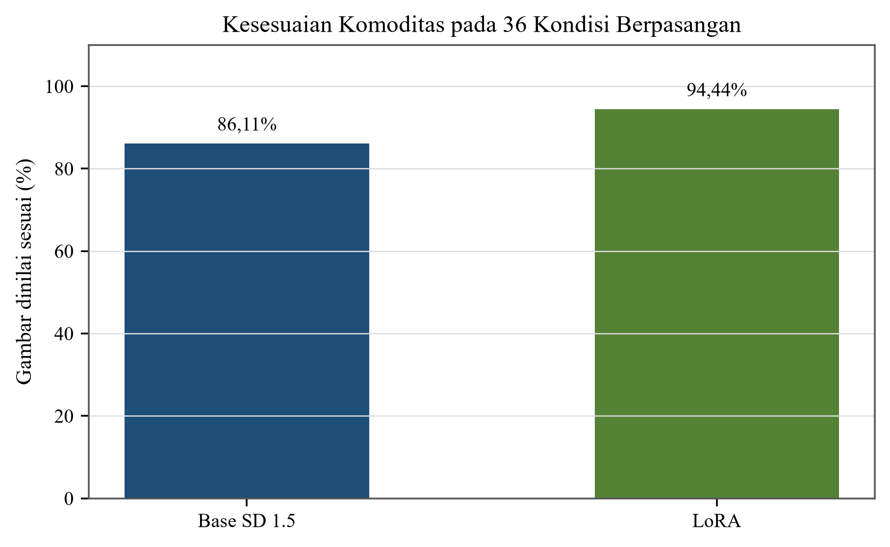
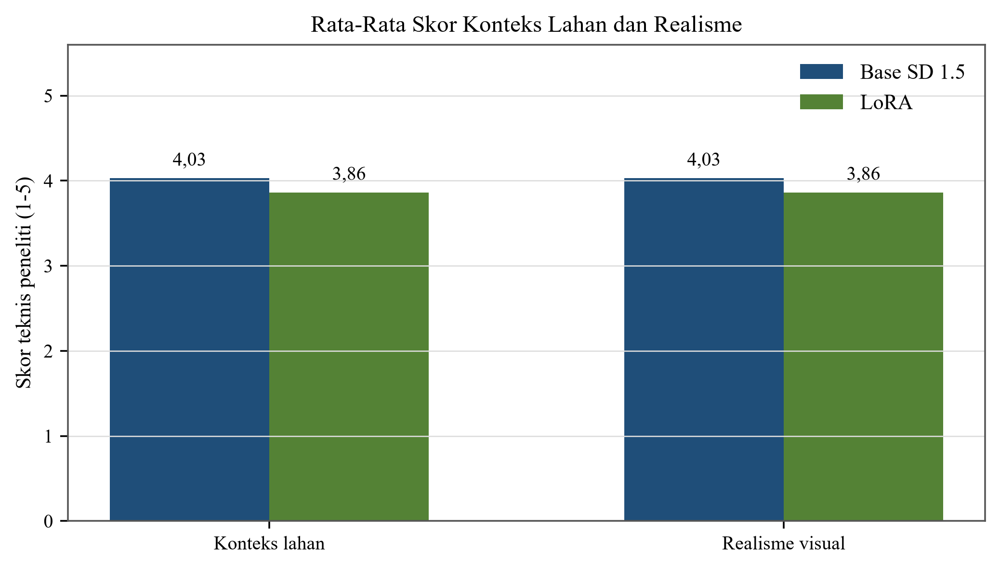
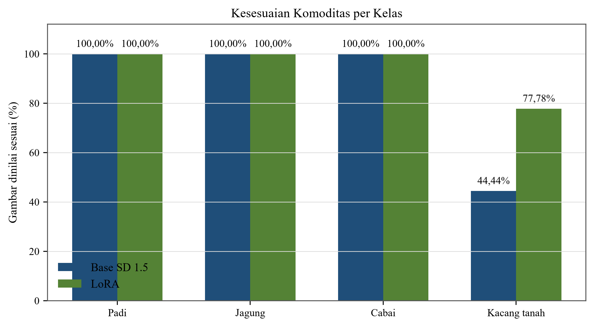
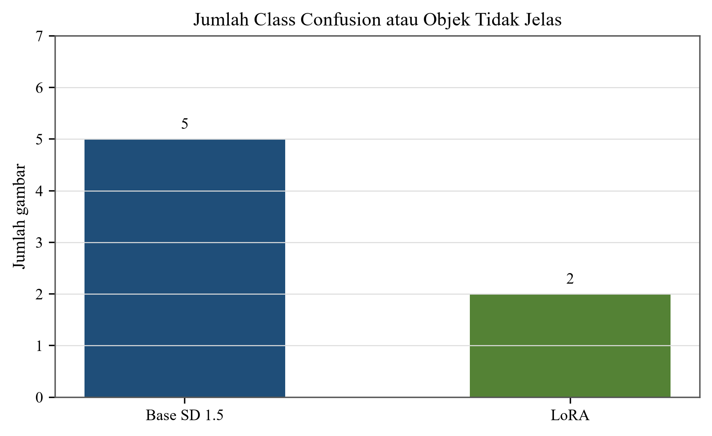
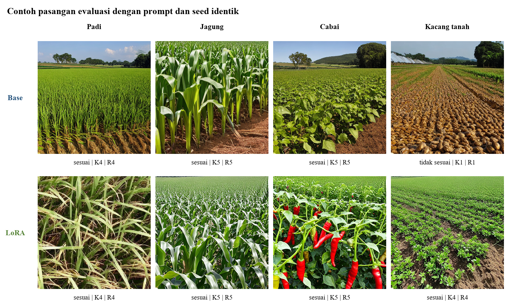

# BAB IV

# HASIL DAN PEMBAHASAN

## 4.1 Hasil Perancangan Sistem

Hasil penelitian pada bab ini disusun berdasarkan tahapan Research and Development (R&D) yang telah dijelaskan pada BAB III, khususnya tahap pengembangan produk, pengujian produk, dan penyempurnaan. Produk yang dihasilkan berupa aplikasi mobile TaniAdaptif yang menghubungkan data cuaca BMKG, input kondisi lahan, rule-based engine, penyimpanan lokal, serta layanan simulasi visual berbasis Stable Diffusion 1.5 dengan bobot LoRA. Pemisahan tanggung jawab antarkomponen dipertahankan dalam implementasi: rule-based engine menentukan rekomendasi tanaman, sedangkan Stable Diffusion dan LoRA hanya menghasilkan simulasi visual dari tanaman yang sudah direkomendasikan.

Implementasi perangkat lunak dilakukan pada beberapa lapisan. Flutter menjadi antarmuka Android; Express menjadi backend publik aplikasi sekaligus pemilik rule-based engine dan proxy inference; API BMKG menjadi sumber data cuaca wilayah Aikmel; FastAPI menyediakan kontrak inference; dan layanan GPU disiapkan untuk memuat Stable Diffusion 1.5 beserta LoRA final. Laptop pengembangan tidak menjalankan training atau Stable Diffusion. Training final dijalankan pada GPU Kaggle, sedangkan laptop hanya digunakan untuk pengembangan aplikasi, validasi artefak, pengujian CPU, dan penyusunan laporan.

### 4.1.1 Hasil Implementasi Arsitektur Sistem

Alur implementasi dimulai ketika Flutter meminta informasi cuaca kepada Express. Backend mengambil data BMKG berdasarkan kode ADM4 Aikmel, menormalkan respons, dan mengirimkan data yang diperlukan aplikasi. Setelah pengguna mengisi jenis lahan, ketersediaan air, dan tanaman sebelumnya, backend menggabungkan input tersebut dengan kategori curah hujan untuk memilih aturan. Keluaran rule-based engine memuat tanaman prioritas, alternatif, alasan, ringkasan input, dan rule ID. Hasil ini dapat ditampilkan tanpa menunggu layanan generatif.

Jika pengguna meminta simulasi visual, Flutter membentuk payload terstruktur dari rekomendasi dan mengirimkannya kembali ke Express. Express melakukan autentikasi, pembatasan laju, dan proxy ke FastAPI tanpa membuka URL internal atau token inference kepada aplikasi. FastAPI kemudian membentuk prompt menggunakan trigger token komoditas dan, pada lingkungan GPU yang nyata, akan menjalankan Stable Diffusion 1.5 dengan LoRA. Hasil PNG diteruskan melalui endpoint Express agar Flutter tetap hanya bergantung pada satu backend publik. Ringkasan status setiap komponen ditampilkan pada Tabel 4.1.

**Tabel 4.1 Ringkasan Hasil Implementasi Komponen Sistem**

| Komponen | Hasil implementasi | Status bukti |
| --- | --- | --- |
| Aplikasi mobile | Flutter Android memuat dashboard cuaca, form lahan, hasil rekomendasi, kalender empat minggu, dan permintaan simulasi visual | Terimplementasi dan diuji otomatis |
| Data cuaca | Express mengambil dan menormalkan API BMKG untuk ADM4 Aikmel dengan timeout dan cache | Kontrak dan respons live tercatat |
| Rekomendasi | Rule-based engine mempunyai 30 kunci utama, empat kelas keluaran, alasan, dan rule ID | 30/30 kunci diuji deterministik |
| Simulasi visual | Flutter ke Express proxy ke FastAPI ke provider Diffusers pada GPU | Kontrak mock lulus; E2E GPU nyata belum tersedia |
| Model visual | Stable Diffusion 1.5 dengan LoRA final dari run `20260820T143551Z` | Training, export, sanity, dan evaluasi selesai |
| Penyimpanan lokal | Cache cuaca, cache rekomendasi berbasis signature, dan riwayat visual maksimal 20 entri | Penyimpanan diuji; layar riwayat khusus belum tersedia |

*Sumber: Kode aplikasi TaniAdaptif dan artefak pengujian, 2026.*

Arsitektur tersebut menjaga rekomendasi tetap dapat digunakan ketika layanan visual gagal. Widget test membuktikan bahwa rekomendasi Jagung tetap terlihat saat permintaan visual menghasilkan error. Dengan demikian, fungsi keputusan tidak bergantung pada ketersediaan GPU. Hal ini juga membatasi dampak kegagalan model generatif pada fungsi utama aplikasi.

### 4.1.2 Hasil Implementasi Aplikasi Mobile

Aplikasi Flutter terdiri atas splash screen, dashboard, form kondisi lahan, dan halaman hasil rekomendasi. Dashboard memanggil repository untuk mengambil data cuaca melalui backend. Repository terlebih dahulu mencoba jaringan, menyimpan respons yang berhasil, dan dapat mengembalikan cache lokal disertai pemberitahuan ketika jaringan gagal. Antarmuka menyediakan refresh dan pesan kesalahan yang dapat ditindaklanjuti tanpa menutup aplikasi.

Halaman hasil menampilkan ringkasan cuaca, daftar tanaman berdasarkan urutan prioritas, alasan rekomendasi, kalender satu bulan, serta kontrol untuk membuat simulasi visual. Kegagalan visual ditampilkan sebagai status terpisah sehingga hasil rule-based engine tidak hilang. Model data Flutter juga menyimpan request ID dan provenance respons visual untuk membantu penelusuran alur.

`[SCREENSHOT ANDROID BELUM TERSEDIA]`

Placeholder tersebut diperuntukkan bagi screenshot beranda dan informasi cuaca dari perangkat Android nyata. Screenshot tidak diganti dengan mockup karena bukti antarmuka final harus memperlihatkan konfigurasi aplikasi yang sama dengan pengujian E2E.

### 4.1.3 Hasil Integrasi Data Cuaca BMKG

Backend menggunakan kode ADM4 `52.03.09.2002` untuk Kelurahan Aikmel. Respons BMKG diubah menjadi struktur yang memuat lokasi, cuaca saat ini, daftar titik prakiraan, cakupan curah hujan, waktu pengambilan, serta status cache. Nilai numerik yang tidak tersedia dipertahankan sebagai `null`; backend tidak mengisi curah hujan yang hilang dengan estimasi buatan. Permintaan jaringan menggunakan timeout 15 detik dan cache 30 menit. Jika pengambilan baru gagal tetapi cache lama tersedia, respons diberi status `stale-cache` agar aplikasi mengetahui bahwa data bukan hasil jaringan terbaru.

Proyeksi setara 30 hari hanya dihitung ketika setiap titik prakiraan pada horizon memiliki nilai curah hujan. Perhitungan dilakukan dari rata-rata hujan harian pada horizon BMKG yang tersedia kemudian dikalikan 30. Nilai tersebut digunakan sebagai input kategorisasi rendah, sedang, atau tinggi. Proyeksi ini bukan prakiraan bulanan resmi BMKG. Jika cakupan data hujan tidak lengkap, kategori otomatis tidak dibuat dan rekomendasi otomatis menolak untuk mengarang input.

Uji live yang terdokumentasi pada 5 Agustus 2026 menghasilkan 18 titik prakiraan pada tiga hari dengan 18 nilai curah hujan tersedia. Hasil tersebut adalah rekaman pengujian pada waktu tertentu dan tidak ditafsirkan sebagai kondisi cuaca saat penyusunan bab ini. Rinciannya disajikan pada Tabel 4.2.

**Tabel 4.2 Hasil Integrasi Data Cuaca BMKG Wilayah Aikmel**

| Item | Hasil aktual |
| --- | --- |
| Waktu uji tercatat | 5 Agustus 2026, 11:50:22 UTC |
| Kode wilayah | `52.03.09.2002` |
| Lokasi | Aikmel, Kecamatan Aikmel, Lombok Timur, Nusa Tenggara Barat |
| Jumlah titik prakiraan | 18 |
| Horizon yang teramati | 3 hari |
| Titik dengan data curah hujan | 18/18 atau lengkap |
| Sumber respons | BMKG |
| Status cache pengambilan awal | `network`, tidak stale |
| Keluaran rule engine pada skenario uji | Cabai; `ROT-RENDAH-CUKUP-PADI-SAWAH` |

*Sumber: `artifacts/test_reports/node_bmkg_live_contract.json`, 2026.*

Integrasi BMKG menghasilkan data terstruktur yang dapat dipakai sebagai salah satu input aturan. Data cuaca tidak langsung menjadi rekomendasi; kategori hasil normalisasi tetap diproses bersama variabel lahan dan tanaman sebelumnya.

### 4.1.4 Hasil Implementasi Input Kondisi Lahan

Form lahan menerima tiga input dari pengguna, yaitu jenis lahan, ketersediaan air, dan tanaman sebelumnya. Jenis lahan dibatasi menjadi sawah, tegalan, dan kebun campur. Ketersediaan air terdiri atas cukup, terbatas, dan kurang. Tanaman sebelumnya terdiri atas padi, jagung, cabai, kacang tanah, dan kondisi lahan kosong. Pembatasan pilihan melalui komponen dropdown mengurangi kemungkinan nilai di luar kontrak, sedangkan backend tetap mengulang validasi agar payload yang tidak sah ditolak.

Ketika form diproses, repository membuat signature dari kombinasi input. Cache rekomendasi hanya dapat dipakai kembali jika signature sama, sehingga hasil untuk lahan atau tanaman sebelumnya yang berbeda tidak tertukar. Pengujian repository membuktikan cache dengan signature berbeda tidak dimuat.

`[SCREENSHOT ANDROID BELUM TERSEDIA]`

Placeholder tersebut akan diganti dengan screenshot form kondisi lahan pada perangkat Android. Screenshot harus menunjukkan seluruh input yang benar-benar dipakai rule-based engine.

### 4.1.5 Hasil Implementasi Rule-Based Engine dan Rekomendasi

Implementasi rule-based engine menggunakan 30 kunci utama yang merupakan kombinasi tiga kategori curah hujan, dua kategori air untuk pencarian aturan, dan lima nilai tanaman sebelumnya. Input air `kurang` diterima oleh kontrak, kemudian diperlakukan sebagai `terbatas` saat pencarian aturan dan ditambahkan peringatan mengenai keterbatasan air. Jenis lahan tidak menjadi bagian dari kunci tabel utama, tetapi digunakan untuk menyesuaikan prioritas. Pada lahan non-sawah, padi dapat dipindahkan ke urutan alternatif tanpa dihapus dari daftar apabila memang berasal dari aturan.

Setiap hasil memuat `recommendedCrop`, daftar rekomendasi berurutan, alasan, `inputSummary`, kunci aturan, indikator penggunaan default, dan rule ID. Rule ID dibentuk dari kunci serta jenis lahan sehingga keluaran dapat ditelusuri. Tabel 4.3 menunjukkan kontrak implementasi aktual.

**Tabel 4.3 Kontrak Implementasi Rule-Based Engine**

| Aspek | Nilai aktual | Penanganan dalam sistem |
| --- | --- | --- |
| Kategori hujan | tinggi, sedang, rendah | Diturunkan dari proyeksi setara 30 hari hanya ketika cakupan horizon lengkap |
| Ketersediaan air | cukup, terbatas, kurang | `kurang` dinormalisasi ke `terbatas` untuk pencarian aturan dan diberi peringatan |
| Tanaman sebelumnya | padi, jagung, cabai, kacang tanah, kosong | Menjadi bagian kunci aturan |
| Jenis lahan | sawah, tegalan, kebun campur | Memengaruhi urutan prioritas dan rule ID |
| Jumlah kunci utama | 30 | 3 kategori hujan x 2 kategori air pencarian x 5 tanaman sebelumnya |
| Keluaran | padi, jagung, cabai, kacang tanah | Urutan prioritas, alasan, dan rule ID dapat diaudit |

*Sumber: `backend-nodejs/src/config/aturanRotasi.js` dan `rekomendasiService.js`, 2026.*

Skenario live yang terekam menggunakan hujan rendah, air cukup, tanaman sebelumnya padi, dan lahan sawah. Keluaran prioritas pertama adalah cabai, diikuti kacang tanah dan padi, dengan rule ID `ROT-RENDAH-CUKUP-PADI-SAWAH`. Hasil ini membuktikan kontrak perangkat lunak dan keterlacakan aturan pada skenario tersebut. Hasil tidak ditafsirkan sebagai validasi agronomi lapangan.

Fungsi kalender menggunakan tanaman prioritas yang sama untuk membentuk empat rentang mingguan: persiapan lahan, penanaman, perawatan awal, serta pemupukan dan monitoring. Minggu pertama memakai ringkasan harian BMKG yang tersedia. Minggu kedua sampai keempat merupakan proyeksi rata-rata dengan tingkat keyakinan rendah. Aplikasi menampilkan catatan metodologi agar kalender tidak dibaca sebagai prakiraan BMKG empat minggu.

`[SCREENSHOT ANDROID BELUM TERSEDIA]`

Placeholder tersebut akan diganti dengan screenshot hasil rekomendasi yang menampilkan tanaman prioritas, alasan, dan kalender empat minggu.

### 4.1.6 Hasil Fine-Tuning Stable Diffusion dengan LoRA

Fine-tuning dilakukan di Kaggle pada run `20260820T143551Z`. Pipeline menjalankan validasi dataset, smoke test 100 langkah, validasi smoke, main training 1.600 langkah, sanity inference, evaluasi Base dan LoRA, serta ekspor artefak. Cell terakhir selesai tanpa exception dan `complete_pipeline_state.json` berstatus `success`. Tidak ada retraining yang dilakukan saat penyusunan BAB IV.

#### 4.1.6.1 Hasil Dataset Final

Dataset final berasal dari proses kurasi dan validasi yang menghasilkan 389 gambar. Sebanyak 312 gambar digunakan untuk training dan 77 gambar untuk validasi. Split dilakukan pada level data yang telah melewati pemeriksaan duplikasi agar tidak terjadi kebocoran duplikat antarsplit. Distribusi kelas ditunjukkan pada Tabel 4.4.

**Tabel 4.4 Distribusi Dataset Final**

| Komoditas | Total final | Training | Validasi |
| --- | ---: | ---: | ---: |
| Padi | 95 | 76 | 19 |
| Jagung | 100 | 80 | 20 |
| Cabai | 97 | 78 | 19 |
| Kacang tanah | 97 | 78 | 19 |
| **Total** | **389** | **312** | **77** |

*Sumber: `final_training_report.json` dan `local_evidence_summary.json`, 2026.*

Sebelum pembatasan final, review dataset menerima 390 gambar dan menolak 85 gambar. Kelas jagung dibatasi secara deterministik menjadi 100 gambar sehingga jumlah final menjadi 389. Seluruh 312 gambar training dan 77 gambar validasi berhasil didekode pada pemeriksaan fisik di runtime training.

#### 4.1.6.2 Konfigurasi Training

Konfigurasi aktual diambil dari `training_config.json` dan laporan run, bukan dari rencana awal. Model dasar adalah Stable Diffusion 1.5. LoRA menggunakan rank 8, resolusi 512 x 512, batch size 1, gradient accumulation 4, learning rate 0,0001, mixed precision FP16, gradient checkpointing, dan optimizer AdamW 8-bit. Konfigurasi lengkap disajikan pada Tabel 4.5.

**Tabel 4.5 Konfigurasi Fine-Tuning LoRA**

| Parameter | Konfigurasi aktual |
| --- | --- |
| Model dasar | `stable-diffusion-v1-5/stable-diffusion-v1-5` |
| Resolusi | 512 x 512 piksel |
| LoRA rank | 8 |
| Train batch size | 1 |
| Gradient accumulation | 4 |
| Learning rate | 0,0001 |
| Optimizer | AdamW 8-bit |
| Mixed precision | FP16 |
| Gradient checkpointing | Aktif |
| Smoke test | 100 langkah; checkpoint setiap 50 langkah |
| Main training | 1.600 langkah; checkpoint setiap 200 langkah |
| Batas checkpoint main | 3 checkpoint |
| Seed | 42 |
| Runtime | Kaggle GPU; 2 Tesla T4 terdeteksi; VRAM perangkat utama 14,56 GiB |
| Commit Diffusers | `0f252be0ed42006c125ef4429156cb13ae6c1d60` |

*Sumber: `training_config.json` dan `final_training_report.json`, 2026.*

#### 4.1.6.3 Hasil Training dan Integritas Model

Smoke test selesai pada langkah 100 dengan return code 0. Checkpoint-50, checkpoint-100, dan file LoRA smoke dinyatakan valid. Main training kemudian selesai pada langkah 1.600 dengan return code 0 dan checkpoint-1600 valid. File default Diffusers `pytorch_lora_weights.safetensors` dipertahankan, lalu disalin secara aman menjadi nama canonical `multisource_multicrop_lora.safetensors` setelah validasi. Hasil kedua tahap ditampilkan pada Tabel 4.6.

**Tabel 4.6 Hasil Smoke Test dan Main Training**

| Tahap | Status | Langkah aktual | Waktu | Checkpoint | Observasi loss | Output canonical |
| --- | --- | ---: | ---: | --- | ---: | --- |
| Smoke | PASS | 100 | 250,79 detik | 50 dan 100 valid | 501 | `multisource_multicrop_smoke_lora.safetensors` |
| Main | SUCCESS | 1.600 | 3.346,29 detik | 1.600 valid | 8.001 | `multisource_multicrop_lora.safetensors` |

*Sumber: `smoke_validation.json` dan `main_validation.json`, 2026.*

Model final berukuran 6.414.992 byte, memuat 256 tensor, dan mempunyai SHA-256 `0bda8908d577513110c22cf5ec1b8a7e008d2b26dd90525732a5c4e4b1bdd43a`. Validator lokal memeriksa struktur SafeTensors, hash, manifest, loss finite, status pipeline, CRC ZIP, serta 76 PNG dari sanity dan evaluasi tanpa memuat Stable Diffusion pada laptop. Empat gambar sanity dinyatakan valid. ZIP ekspor berisi 100 file, berukuran 51.940.573 byte, dan mempunyai SHA-256 `54ee68fccbb88be07a089365c2e62f9e6004e2774992973debe665d5dc0eb26a`.

#### 4.1.6.4 Hasil Loss Training

Loss main tercatat sebanyak 8.001 observasi. Jumlah observasi log lebih besar daripada 1.600 langkah optimizer, sehingga sumbu horizontal grafik dinyatakan sebagai observasi loss, bukan langkah training. Ringkasan statistik loss ditampilkan pada Tabel 4.7.

**Tabel 4.7 Ringkasan Loss Training**

| Tahap | Observasi | Pertama | Terakhir | Mean | Median | Minimum | Maksimum | Mean 100 awal | Mean 100 akhir |
| --- | ---: | ---: | ---: | ---: | ---: | ---: | ---: | ---: | ---: |
| Smoke | 501 | 0,782000 | 0,288000 | 0,196618 | 0,129000 | 0,002050 | 0,894000 | 0,198757 | 0,191906 |
| Main | 8.001 | 0,782000 | 0,004310 | 0,186001 | 0,113000 | 0,001520 | 0,994000 | 0,198757 | 0,180415 |

*Sumber: `main_loss_history.csv`, `smoke_loss_history.csv`, dan `local_evidence_summary.json`, 2026.*

*Gambar 4.1 Grafik Loss Fine-Tuning LoRA pada Main Training*

*Sumber: `main_loss_history.csv`, 2026.*

Gambar 4.1 memperlihatkan loss per observasi yang fluktuatif, disertai rata-rata bergerak 100 observasi. Mean 100 observasi terakhir main adalah 0,180415, lebih rendah daripada mean 100 observasi awal 0,198757. Nilai loss digunakan sebagai indikator proses optimisasi dan bukti bahwa log training finite. Loss tidak digunakan sebagai bukti tunggal kualitas visual karena kualitas identitas komoditas, konteks lahan, dan realisme dinilai melalui evaluasi terpisah.

### 4.1.7 Hasil Evaluasi Visual Base SD 1.5 dan LoRA

Evaluasi visual menggunakan 36 kondisi yang mencakup empat komoditas. Setiap kondisi mempunyai satu gambar Base SD 1.5 dan satu gambar LoRA, sehingga totalnya 72 gambar. Prompt, seed, target kelas, resolusi, jumlah langkah inference, dan guidance scale dibuat identik di dalam setiap pasangan. Setiap komoditas memiliki sembilan kondisi, yaitu tiga prompt dikombinasikan dengan tiga seed. Seluruh 72 PNG dapat dibuka dan seluruh 72 baris review selesai.

Penilaian dilakukan sebagai evaluasi visual teknis oleh peneliti. Variabel yang diisi adalah kesesuaian komoditas, kualitas konteks lahan pada skala 1-5, realisme visual pada skala 1-5, serta class confusion. Analyzer memverifikasi bahwa tidak ada skor otomatis yang dimasukkan. Identitas penilai tidak diverifikasi secara independen oleh perangkat lunak; provenance yang tersedia menyatakan peran `Peneliti`.

#### 4.1.7.1 Hasil Keseluruhan

Hasil keseluruhan disajikan pada Tabel 4.8. Base SD 1.5 menghasilkan 31 dari 36 gambar yang dinilai sesuai dengan komoditas target, sedangkan LoRA menghasilkan 34 dari 36 gambar. Selisihnya adalah +8,33 poin persentase. Sebaliknya, mean dan median skor konteks serta realisme keseluruhan sedikit lebih tinggi pada Base.

**Tabel 4.8 Hasil Evaluasi Visual Keseluruhan**

| Metrik | Base SD 1.5 | LoRA | Selisih deskriptif |
| --- | ---: | ---: | ---: |
| Kesesuaian komoditas | 31/36 (86,11%) | 34/36 (94,44%) | +8,33 poin persentase |
| Konteks lahan, mean; median | 4,0278; 4,5 | 3,8611; 4,0 | -0,1667 pada mean |
| Realisme visual, mean; median | 4,0278; 4,5 | 3,8611; 4,0 | -0,1667 pada mean |
| Cross-class atau objek tidak jelas | 5 | 2 | -3 gambar |

*Sumber: `human_review_analysis.json`, 2026.*

*Gambar 4.2 Perbandingan Kesesuaian Komoditas Base SD 1.5 dan LoRA*

*Sumber: Hasil evaluasi visual teknis oleh peneliti, 2026.*

Gambar 4.2 menunjukkan peningkatan deskriptif kesesuaian komoditas dari 86,11% menjadi 94,44%. Grafik hanya merangkum proporsi penilaian pada 36 pasangan dan tidak menyatakan signifikansi statistik.

*Gambar 4.3 Perbandingan Rata-Rata Skor Konteks Lahan dan Realisme Visual*

*Sumber: Hasil evaluasi visual teknis oleh peneliti, 2026.*

Gambar 4.3 memperlihatkan mean konteks dan realisme Base sebesar 4,03 dibandingkan 3,86 pada LoRA. Karena skala 1-5 bersifat ordinal, median menjadi ringkasan utama, sedangkan mean ditampilkan sebagai deskripsi tambahan. Median kedua metrik adalah 4,5 pada Base dan 4,0 pada LoRA.

#### 4.1.7.2 Hasil per Komoditas

Hasil per kelas pada Tabel 4.9 menunjukkan bahwa padi, jagung, dan cabai mencapai 9/9 gambar sesuai pada Base maupun LoRA. Perubahan terbesar terjadi pada kacang tanah, dari 4/9 gambar sesuai pada Base menjadi 7/9 pada LoRA. Median konteks dan realisme kacang tanah meningkat dari 2 menjadi 4, sedangkan jumlah objek tidak jelas turun dari lima menjadi dua.

**Tabel 4.9 Hasil Evaluasi Visual per Komoditas**

| Komoditas | Pasangan | Benar Base | Benar LoRA | Median konteks Base/LoRA | Median realisme Base/LoRA | Unclear Base/LoRA |
| --- | ---: | ---: | ---: | ---: | ---: | ---: |
| Padi | 9 | 9/9 | 9/9 | 4/4 | 4/4 | 0/0 |
| Jagung | 9 | 9/9 | 9/9 | 5/4 | 5/4 | 0/0 |
| Cabai | 9 | 9/9 | 9/9 | 5/5 | 5/5 | 0/0 |
| Kacang tanah | 9 | 4/9 | 7/9 | 2/4 | 2/4 | 5/2 |

*Sumber: `human_review_analysis.json`, 2026.*

*Gambar 4.4 Perbandingan Kesesuaian Komoditas per Kelas*

*Sumber: Hasil evaluasi visual teknis oleh peneliti, 2026.*

Gambar 4.4 memperjelas bahwa selisih keseluruhan berasal dari tiga pasangan kacang tanah yang berubah dari tidak sesuai pada Base menjadi sesuai pada LoRA. Tidak terdapat pasangan yang sesuai pada Base kemudian menjadi tidak sesuai pada LoRA. Namun, peningkatan identitas komoditas tidak otomatis berarti seluruh aspek visual membaik. Pada kelas jagung, mean konteks dan realisme turun dari 5,0000 menjadi 3,6667, walaupun seluruh gambar tetap dikenali sebagai jagung.

*Gambar 4.5 Perbandingan Jumlah Class Confusion atau Objek Tidak Jelas*

*Sumber: Hasil evaluasi visual teknis oleh peneliti, 2026.*

Nilai `class_confusion` yang sama dengan kelas target diperlakukan analyzer sebagai konfirmasi target, bukan confusion. Gambar 4.5 hanya menghitung label lintas kelas atau `unclear`, yaitu lima pada Base dan dua pada LoRA.

#### 4.1.7.3 Uji Statistik Berpasangan

Kesesuaian komoditas berbentuk data biner berpasangan, sehingga analyzer menggunakan exact McNemar pada pasangan discordant. Konteks dan realisme berupa skor ordinal berpasangan, sehingga arah perbedaan diuji dengan exact sign test dua sisi setelah tie dikeluarkan. Hasil keseluruhan ditampilkan pada Tabel 4.10.

**Tabel 4.10 Hasil Uji Statistik Berpasangan**

| Metrik | Uji | LoRA menang | Tie | Base menang | Non-tie | Exact p-value |
| --- | --- | ---: | ---: | ---: | ---: | ---: |
| Kesesuaian komoditas | Exact McNemar | 3 | 33 | 0 | 3 | 0,25 |
| Konteks lahan | Exact sign test | 6 | 21 | 9 | 15 | 0,6072387695 |
| Realisme visual | Exact sign test | 6 | 21 | 9 | 15 | 0,6072387695 |

*Sumber: `human_review_analysis.json`, 2026.*

Interpretasi utama penelitian adalah: LoRA menunjukkan peningkatan kesesuaian komoditas secara deskriptif, tetapi perbedaan tersebut tidak signifikan secara statistik pada taraf signifikansi 0,05 berdasarkan exact McNemar. Exact sign test keseluruhan juga tidak menunjukkan perbedaan signifikan untuk konteks lahan atau realisme visual.

Analisis per kelas bersifat eksploratif karena setiap kelas hanya mempunyai sembilan pasangan dan dilakukan beberapa perbandingan. Pada jagung, skor konteks dan realisme lebih sering memihak Base dengan exact sign test `p=0,03125`. Pada kacang tanah, arah perbedaannya berlawanan dan lebih sering memihak LoRA, juga dengan `p=0,03125`. Dua hasil tersebut menunjukkan efek LoRA tidak seragam antar-komoditas dan tidak boleh diringkas sebagai keunggulan visual menyeluruh.

#### 4.1.7.4 Metrik Proxy Otomatis dan Contoh Visual

Pipeline juga menghitung brightness, contrast, dan entropy sebagai pemeriksaan teknis otomatis. Tabel 4.11 menyajikan mean keseluruhan. Ketiga nilai hanya digunakan untuk mendeteksi karakteristik gambar dan bukan skor identitas komoditas, realisme, ketepatan agronomi, atau preferensi pengguna.

**Tabel 4.11 Metrik Proxy Otomatis Base dan LoRA**

| Varian | Gambar | Brightness mean | Contrast mean | Entropy mean |
| --- | ---: | ---: | ---: | ---: |
| Base SD 1.5 | 36 | 90,883615 | 60,444080 | 9,008533 |
| LoRA | 36 | 97,651167 | 62,275424 | 9,104648 |

*Sumber: `proxy_metrics_summary.csv`, 2026. Metrik bersifat proxy deskriptif.*

*Gambar 4.6 Contoh Pasangan Base-LoRA dengan Prompt dan Seed Identik*

*Sumber: Gambar evaluasi aktual kondisi `p1_s42` dan review teknis peneliti, 2026.*

Gambar 4.6 menampilkan satu kondisi yang dipilih secara konsisten untuk setiap komoditas, yaitu prompt pertama dan seed 42. Panel tidak dimaksudkan sebagai sampel representatif seluruh 36 pasangan. Pada padi, jagung, dan cabai, kedua varian dinilai sesuai pada kondisi tersebut. Pada kacang tanah, Base dinilai tidak sesuai dengan konteks dan realisme 1, sedangkan LoRA dinilai sesuai dengan skor 4. Gambar asli tidak diubah isinya; penyusunan hanya menempatkan delapan PNG dalam satu panel dan menambahkan label dari CSV review.

### 4.1.8 Hasil Implementasi Simulasi Visual

FastAPI telah menyediakan health, readiness, model info, generation, validasi input, timeout, retry terbatas, penguncian satu proses generasi, validasi hash LoRA, serta pemeriksaan CUDA. Provider Diffusers dirancang gagal tertutup jika CUDA tidak tersedia atau hash model tidak sama dengan model final. Express menyimpan token inference privat, menerapkan token klien sementara dan rate limit, menyembunyikan URL upstream, serta melayani PNG melalui domain backend.

Kontrak lokal dari Express ke FastAPI mock dan kembali ke Express PNG telah lulus. Laporan kontrak secara eksplisit mencatat `real_stable_diffusion=false`, `real_lora_loaded=false`, provider `mock`, dan device `cpu`. Oleh karena itu, hasil tersebut hanya membuktikan alur API dan tidak menjadi bukti bahwa Stable Diffusion dengan LoRA telah aktif di aplikasi Android.

`[BUKTI E2E GPU BELUM TERSEDIA]`

`[SCREENSHOT ANDROID BELUM TERSEDIA]`

Bagian ini baru dapat difinalkan setelah host GPU menghasilkan `gpu_preflight.json` berstatus sukses, backend melaporkan provider Diffusers pada CUDA dengan hash model final, probe E2E menerima PNG nyata, dan gambar yang sama terlihat pada aplikasi Android.

### 4.1.9 Hasil Penyimpanan Riwayat

Penyimpanan lokal menggunakan SharedPreferences untuk cache cuaca, cache rekomendasi, dan riwayat visual. Setiap entri riwayat visual memuat request ID, tanaman, URL gambar backend, seed, model, prompt, waktu, dan ringkasan konteks. Daftar dibatasi pada 20 entri terbaru. Pengujian menyimpan 25 fixture dan membuktikan entri `request-24` sampai `request-5` dipertahankan sesuai urutan terbaru.

Pada kondisi repository saat audit, mekanisme penyimpanan telah tersedia, tetapi belum ditemukan layar Flutter yang memanggil `loadVisualHistory()` untuk menampilkan daftar tersebut. Dengan demikian, hasil bagian ini berstatus implementasi parsial: data riwayat dapat disimpan dan dibaca melalui service, tetapi navigasi pengguna menuju daftar riwayat belum dapat dibuktikan.

`[SCREENSHOT ANDROID BELUM TERSEDIA]`

Screenshot riwayat baru dapat diambil setelah layar riwayat benar-benar tersedia atau rancangan BAB III disesuaikan dengan kemampuan aplikasi aktual.

## 4.2 Pengujian Sistem

Pengujian sistem menggabungkan Black Box Testing berbasis kontrak, unit/integration test otomatis, pemeriksaan artefak, dan respons live yang terdokumentasi. Pengujian berfokus pada masukan, keluaran, status error, dan perilaku komponen tanpa menjadikan struktur internal sebagai kriteria pengguna. Test otomatis digunakan sebagai bukti teknis, bukan sebagai UAT. Tidak ada responden petani, wawancara, kuesioner pengguna, atau validasi ahli yang dilaporkan.

Tabel 4.12 memisahkan hasil yang benar-benar lulus, pengujian berprovider mock, dan pengujian yang belum dilakukan. Baris mock membuktikan kontrak perangkat lunak saja. Baris E2E GPU dan Android diberi status belum diuji serta tidak dihitung sebagai kelulusan.

**Tabel 4.12 Hasil Black Box Testing**

| No. | Fitur | Skenario Pengujian | Input | Hasil yang Diharapkan | Hasil Aktual | Status |
| ---: | --- | --- | --- | --- | --- | --- |
| 1 | Health backend | Memanggil endpoint kesehatan | `GET /api/kesehatan` | HTTP 200 dan status layanan | Kontrak kesehatan terpenuhi | Lulus |
| 2 | Validasi rekomendasi | Mengirim input valid dan tidak lengkap | `POST /api/rekomendasi` | Input valid diproses; input salah ditolak | Rule ID dikembalikan dan payload salah ditolak | Lulus |
| 3 | Parser BMKG | Field curah hujan tidak tersedia | Fixture tanpa `tp` | Nilai dipertahankan `null` | Tidak dibuat nilai hujan fiktif | Lulus |
| 4 | Cache BMKG | Network, cache segar, lalu timeout | Tiga permintaan berurutan | `network` ke `fresh-cache` ke `stale-cache` | Urutan fallback teramati | Lulus |
| 5 | Decision table | Menjalankan seluruh kunci aturan | 30 kombinasi hujan-air-tanaman | Keluaran valid dan dapat diaudit | 30/30 kunci menghasilkan empat kelas terbatas | Lulus |
| 6 | Penyesuaian lahan | Membandingkan sawah dan non-sawah | Input cuaca, air, dan tanaman sama | Jenis lahan memengaruhi prioritas | Prioritas berubah deterministik dan rule ID berbeda | Lulus |
| 7 | Kalender rekomendasi | Membentuk rencana satu bulan | Kondisi valid dan tanggal acuan | Empat rentang mingguan stabil | Empat minggu dengan tanggal stabil | Lulus |
| 8 | Integrasi BMKG live | Mengambil cuaca ADM4 Aikmel | `52.03.09.2002` | Respons lokasi dan horizon dapat diproses | Uji 5 Agustus 2026: 18 titik/3 hari; 18 `tp` lengkap | Lulus |
| 9 | FastAPI health/ready | Menjalankan provider lokal aman | `GET /health` dan `/ready` | Status provider eksplisit | HTTP 200, provider mock dan CPU terlabel jelas | Lulus (mock) |
| 10 | Validasi inference | Crop, dimensi, atau prompt tidak valid | Payload di luar kontrak | HTTP 422 terstruktur | `VALIDATION_ERROR` dikembalikan | Lulus |
| 11 | Timeout inference | Provider gagal atau lambat | Fixture error dan timeout | Retry terbatas; HTTP 503/504 | Satu retry untuk error; timeout tidak diulang | Lulus |
| 12 | Akses visual backend | Token kosong/placeholder dan rate limit | Route `/api/visual` | Akses ditolak atau dibatasi | Token salah ditolak dan rate limit aktif | Lulus |
| 13 | Proxy pembangkitan | Meneruskan konteks rekomendasi | `POST /api/visual/generate` | Request ID tetap dan URL upstream tersembunyi | Kontrak terpenuhi pada provider mock | Lulus (mock) |
| 14 | Pengiriman PNG | Mengambil gambar melalui Express | `GET /api/visual/images/*.png` | PNG valid dari domain backend | PNG mock valid dan URL upstream tidak terbuka | Lulus (mock) |
| 15 | Cache cuaca Flutter | Jaringan gagal setelah data tersimpan | Simulasi offline | Cache lokal ditampilkan | Data cache termuat dengan notice | Lulus |
| 16 | Cache rekomendasi Flutter | Mencari cache dengan signature input | Signature sama dan berbeda | Hanya signature sama dimuat | Perilaku sesuai kontrak | Lulus |
| 17 | Isolasi kegagalan visual | Provider visual gagal | Rekomendasi Jagung dan error visual | Rekomendasi tetap terlihat | Widget tetap menampilkan Jagung | Lulus |
| 18 | Riwayat visual | Menyimpan 25 entri | 25 fixture riwayat | Maksimal 20 entri terbaru | `request-24` sampai `request-5` tersimpan | Lulus |
| 19 | Artefak LoRA | Memvalidasi model dan export | ZIP run `20260820T143551Z` | Hash, tensor, manifest, PNG, dan loss valid | 100 file; 256 tensor; 76 PNG; error 0 | Lulus |
| 20 | Human review analyzer | Menganalisis review final | 72 penilaian/36 pasangan | Pair identik, tidak kosong, tanpa skor otomatis | Seluruh pemeriksaan true; JSON/CSV/Markdown terbentuk | Lulus |
| 21 | Inference E2E GPU | Flutter-backend-FastAPI-CUDA-LoRA-PNG | Host GPU nyata | Diffusers CUDA, hash final, PNG 512 x 512 | `[BUKTI E2E GPU BELUM TERSEDIA]` | Belum diuji |
| 22 | Tampilan Android nyata | Menampilkan PNG E2E pada perangkat | APK dan backend GPU nyata | Gambar LoRA termuat dan terdokumentasi | `[SCREENSHOT ANDROID BELUM TERSEDIA]` | Belum diuji |

*Sumber: Test backend, Python, Flutter, kontrak live, dan validator artefak TaniAdaptif, 2026.*

Pengujian regresi dijalankan ulang pada 21 Agustus 2026. Hasil terbaru menggantikan jumlah test pada laporan lama. Ringkasan ditampilkan pada Tabel 4.13.

**Tabel 4.13 Ringkasan Verifikasi Perangkat Lunak**

| Lapisan | Perintah/verifikasi | Hasil aktual | Status |
| --- | --- | --- | --- |
| Python dataset/LoRA | `pytest ml_pipeline/tests` | 96 passed | Lulus |
| Python inference API | `pytest inference_api/tests` | 29 passed | Lulus |
| Python total | Kedua suite Python | 125 passed dalam 70,13 detik | Lulus |
| Express backend | `npm test` | 23 passed; 0 failed | Lulus |
| Flutter | `flutter test` | 13 passed | Lulus |
| Dataset review UI | `npm run dataset-review:test` | 11 passed | Lulus |
| LoRA review UI | `npm run lora-review:test` | 7 passed | Lulus |
| Flutter static analysis | `flutter analyze` | No issues found | Lulus |
| Ruff lint | `ruff check ml_pipeline inference_api` | All checks passed | Lulus |
| Notebook validation | Validator JSON dan source code | 8 notebook valid; notebook Kaggle 52 cell | Lulus |
| Repository preflight | `preflight_check.mjs` | All checks passed | Lulus |
| Secret scan | `security_scan.mjs` | No obvious secrets found | Lulus |
| Python dependency audit | `pip-audit` | No known vulnerabilities found | Lulus |
| Node dependency audit | `npm audit --omit=dev` | 0 vulnerabilities | Lulus |
| Debug APK | Ukuran dan SHA-256 | 152.840.310 byte; SHA-256 `417604f6...cedb5` | Terverifikasi |

*Sumber: `thesis_output/evidence/software_verification_20260821.json`, 2026.*

Hasil tersebut menunjukkan komponen dapat dikompilasi dan kontraknya stabil pada cakupan test yang tersedia. APK yang diverifikasi masih debug-signed dan tidak memuat URL atau token produksi. Keberadaan APK bukan bukti instalasi pada perangkat maupun bukti inference GPU nyata.

## 4.3 Pembahasan

### 4.3.1 Ketercapaian Tujuan Penelitian

Tujuan pertama adalah merancang dan membangun aplikasi mobile yang mengintegrasikan API BMKG, kondisi lahan, dan rule-based engine. Tujuan ini tercapai pada tingkat implementasi dan pengujian perangkat lunak. Flutter dapat mengambil cuaca melalui Express, menerima input lahan, menampilkan rekomendasi, serta mempertahankan hasil ketika visual gagal. Backend dapat menormalisasi respons BMKG dan memproses 30 kunci aturan secara deterministik. Bukti perangkat fisik final masih belum tersedia, sehingga ketercapaian tidak diperluas menjadi klaim keberhasilan operasional lapangan.

Tujuan kedua adalah menerapkan fine-tuning LoRA pada Stable Diffusion untuk menghasilkan simulasi visual empat komoditas. Tujuan ini tercapai pada tingkat training dan evaluasi model. Smoke test 100 langkah dan main training 1.600 langkah selesai pada GPU Kaggle. Model final telah divalidasi berdasarkan ukuran, jumlah tensor, dan SHA-256. Model menghasilkan 72 gambar evaluasi serta empat gambar sanity pada runtime GPU training. Namun, penggunaan model melalui aplikasi Android belum terbukti end-to-end pada host inference.

Tujuan ketiga adalah menguji fungsionalitas aplikasi dan mengevaluasi model secara teknis. Pengujian otomatis mencakup 125 test Python, 23 test backend, 13 test Flutter, dan 18 test UI review. Evaluasi visual teknis mencakup 72 penilaian berpasangan. Dengan demikian, tujuan ketiga tercapai untuk pengujian perangkat lunak, artefak, dan evaluasi visual yang telah dilakukan, tetapi belum lengkap pada jalur Android ke GPU nyata.

### 4.3.2 Pembahasan Integrasi BMKG

Integrasi cuaca menjawab kebutuhan agar informasi BMKG tidak hanya ditampilkan, tetapi diproses sebagai input sistem. Pendekatan ini mempunyai keterkaitan dengan penelitian aplikasi cuaca berbasis Android untuk pertanian [3] dan pemanfaatan data BMKG [14]. Perbedaan implementasi TaniAdaptif adalah penambahan normalisasi cakupan curah hujan, cache dengan status freshness, serta penerusan kategori ke rule-based engine.

Horizon BMKG yang singkat menjadi keterbatasan metodologis. Sistem tidak mempunyai dasar untuk menyatakan prakiraan bulanan resmi. Oleh karena itu, proyeksi empat minggu menggunakan rata-rata horizon dan diberi tingkat keyakinan rendah untuk minggu 2-4. Keputusan ini membuat asumsi sistem eksplisit dan mencegah data yang tidak tersedia dipresentasikan sebagai fakta. Kalender harus dipahami sebagai simulasi aktivitas berdasarkan kondisi saat permintaan, bukan prediksi iklim jangka panjang.

### 4.3.3 Pembahasan Rule-Based Recommendation

Rule-based engine memisahkan fungsi keputusan dari model generatif. Pemisahan ini mendukung keterlacakan karena setiap rekomendasi mempunyai kunci, alasan, dan rule ID. Pendekatan tersebut berada dalam konteks sistem pendukung keputusan pertanian yang dibahas pada penelitian kesesuaian lahan [4] dan pemilihan tanaman [12], tetapi TaniAdaptif menggunakan aturan deterministik yang dirancang untuk empat komoditas, bukan AHP, SAW, atau Fuzzy Weighted Product.

Pengujian 30 kunci membuktikan kelengkapan kontrak perangkat lunak, bukan kebenaran agronomi universal. Aturan hanya menggunakan variabel yang dibatasi dalam BAB I: kategori cuaca, ketersediaan air, tanaman sebelumnya, dan jenis lahan. Sistem tidak memakai hasil laboratorium tanah, varietas, hama, harga pasar, atau prediksi hasil panen. Karena itu, rekomendasi harus dipahami sebagai keluaran prototipe simulasi rotasi tanam dalam ruang lingkup penelitian.

Audit menemukan perbedaan antara Tabel 3.6 dan implementasi. BAB III memakai 12 contoh dengan istilah basah/kering, sedangkan kode final memakai 30 kunci tinggi/sedang/rendah. Perbedaan ini perlu diperbaiki sebelum naskah final agar metode dan hasil menggunakan terminologi yang sama.

### 4.3.4 Pembahasan Implementasi Aplikasi

Implementasi Flutter memperlihatkan bahwa alur cuaca, input, rekomendasi, kalender, dan visual dapat ditempatkan dalam satu aplikasi. Hal ini sejalan secara tematik dengan penggunaan Android pada sistem pertanian [13] serta landasan pengembangan mobile dengan Flutter [17]. TaniAdaptif menambahkan isolasi kegagalan visual, cache berbasis signature, dan proxy backend agar aplikasi tidak menyimpan token inference privat.

Hasil test menunjukkan error jaringan dan error visual telah ditangani tanpa menghilangkan rekomendasi. Aspek ini penting karena layanan BMKG dan GPU merupakan dependensi eksternal. Meski demikian, hasil tersebut belum mengukur pengalaman pengguna atau penerimaan masyarakat. Penelitian ini tidak melakukan UAT, wawancara, kuesioner pengguna, atau studi responden petani, sehingga tidak ada klaim kemudahan penggunaan maupun efektivitas pada pengguna akhir.

Penyimpanan riwayat telah teruji pada service, tetapi layar riwayat belum tersedia. Kesenjangan ini harus diselesaikan sebelum screenshot final atau dinyatakan sebagai keterbatasan produk.

### 4.3.5 Pembahasan Fine-Tuning dan Evaluasi LoRA

Fine-tuning LoRA menerapkan konsep penyesuaian model generatif yang juga dibahas pada penelitian Stable Diffusion untuk karakter visual khusus [5], penerapan LoRA pada Stable Diffusion [6], dan landasan latent diffusion [19]. Perbandingan terhadap penelitian tersebut bersifat konseptual karena dataset, domain, prompt, dan metriknya berbeda. BAB IV tidak menggunakan hasil penelitian terdahulu sebagai benchmark numerik.

Training sukses dan loss finite membuktikan pipeline optimisasi berjalan sampai output final. Namun, loss yang fluktuatif tidak menunjukkan kualitas visual secara langsung. Penilaian gambar berpasangan memberikan bukti yang lebih relevan untuk identitas komoditas, konteks, dan realisme pada dataset evaluasi penelitian.

LoRA meningkatkan kesesuaian komoditas dari 86,11% menjadi 94,44% secara deskriptif. Exact McNemar menghasilkan `p=0,25`, sehingga selisih tersebut tidak signifikan pada taraf 0,05. Median konteks dan realisme keseluruhan justru turun dari 4,5 menjadi 4,0, dengan exact sign test `p=0,6072387695`. Temuan ini menunjukkan LoRA membantu masalah identitas kacang tanah pada beberapa pasangan, tetapi tidak menghasilkan peningkatan seragam pada semua dimensi atau kelas.

Kelas jagung dan kacang tanah mempunyai arah hasil ordinal yang berlawanan. Jagung lebih sering memperoleh skor konteks/realisme lebih tinggi pada Base, sedangkan kacang tanah lebih sering lebih tinggi pada LoRA. Dengan hanya sembilan pasangan per kelas dan beberapa uji eksploratif, hasil ini memerlukan kehati-hatian dan tidak cukup untuk klaim generalisasi di luar prompt, seed, serta empat kelas penelitian.

### 4.3.6 Pembahasan Pengujian dan Keandalan Bukti

Black Box Testing digunakan sesuai landasan pada BAB II [23] dengan memeriksa kontrak input-output, status, dan error. Suite otomatis memberi cakupan berulang untuk parser BMKG, cache, 30 aturan, validasi inference, retry, proxy, storage, serta widget Flutter. Validator artefak menambah pemeriksaan yang tidak dicakup test aplikasi, seperti CRC ZIP, hash model, struktur SafeTensors, manifest, dan keterbacaan PNG.

Pemisahan label `Lulus`, `Lulus (mock)`, dan `Belum diuji` mencegah bukti kontrak disamakan dengan bukti model nyata. Provider mock berguna untuk menguji jalur jaringan tanpa membebani laptop, tetapi tidak menghasilkan data kualitas LoRA. Demikian pula, keberhasilan build APK tidak membuktikan aplikasi sudah terhubung ke GPU.

### 4.3.7 Keterbatasan Penelitian

Keterbatasan penelitian yang masih berlaku adalah sebagai berikut.

1. BMKG menyediakan horizon prakiraan jangka pendek; proyeksi empat minggu mempunyai ketidakpastian dan bukan prakiraan bulanan resmi.
2. Rule-based engine dibatasi pada empat komoditas dan empat kelompok variabel; hasilnya bukan prediksi hasil panen atau validasi agronomi lapangan.
3. Decision table BAB III belum sepenuhnya sama dengan 30 kunci pada implementasi final.
4. Dataset berjumlah 389 gambar dan sumber lokal Aikmel hanya terdapat pada sebagian kelas padi; tiga kelas lain berasal dari sumber publik.
5. Evaluasi visual dilakukan oleh peneliti pada 36 pasangan. Identitas penilai tidak diverifikasi independen dan tidak ada penilai ahli atau responden pengguna yang diklaim.
6. Beberapa hasil per kelas menggunakan sampel sembilan pasangan dan beberapa uji eksploratif, sehingga tidak mendukung generalisasi luas.
7. Metrik brightness, contrast, dan entropy hanya proxy teknis dan tidak mengukur ketepatan komoditas atau agronomi.
8. Layar riwayat khusus belum tersedia meskipun penyimpanan riwayat telah diuji.
9. Inference GPU end-to-end dan screenshot Android dengan PNG nyata belum tersedia.
10. APK masih debug-signed dan belum menjadi artefak rilis produksi.

### 4.3.8 Ringkasan Pembahasan Pra-E2E

Hasil yang tersedia membuktikan bahwa aplikasi, backend, rule-based engine, pipeline training, model LoRA, dan evaluasi visual telah dibangun serta diuji dalam cakupan teknisnya. Rekomendasi tetap berasal dari aturan yang dapat dilacak, sementara LoRA berfungsi sebagai modul visual. LoRA menunjukkan peningkatan deskriptif kesesuaian komoditas terutama pada kacang tanah, tetapi tidak signifikan secara statistik pada exact McNemar dan tidak meningkatkan seluruh skor visual secara seragam.

Draft BAB IV ini hampir final untuk bukti yang sudah tersedia. Dua gerbang terakhir tetap terbuka, yaitu inference nyata pada GPU dan dokumentasi tampilan Android. Setelah kedua bukti tersebut tersedia, subbagian 4.1.8, baris 21-22 Tabel 4.12, lima placeholder screenshot, dan pembahasan keterbatasan dapat diperbarui tanpa mengubah model atau melakukan retraining.
