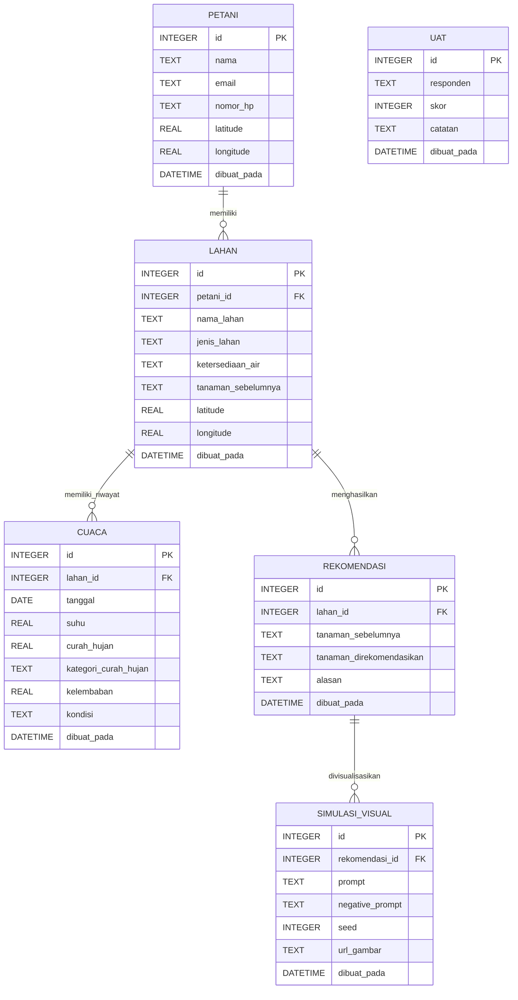
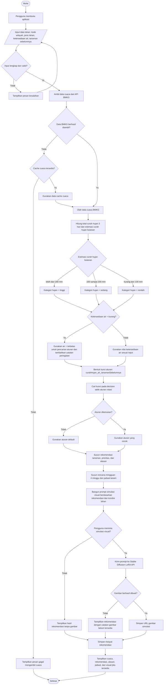

# Kode Draw.io ERD dan Flowchart Tani Adaptif

File ini berisi kode Mermaid yang dapat dimasukkan ke Draw.io/diagrams.net melalui menu:

`Arrange > Insert > Advanced > Mermaid`

## ERD

Catatan rancangan:

- ERD hanya memuat data yang disimpan aplikasi.
- API BMKG dan Stable Diffusion LoRA API tidak dijadikan entitas ERD karena keduanya adalah layanan eksternal.
- Entitas `uat` dibuat terpisah karena pada implementasi database belum memiliki foreign key ke `petani`.

## Flowchart Proses Rekomendasi dan Simulasi Visual

